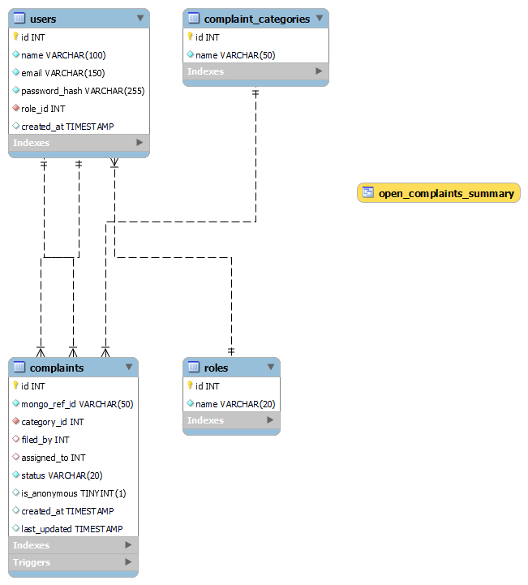
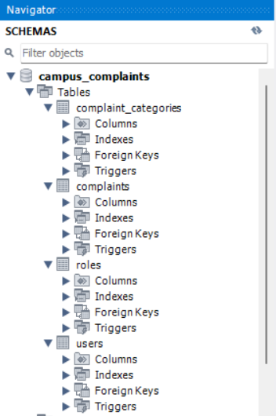

# Campus Lost & Found + Complaint Management System

## 1. Problem Statement
Campus complaint handling (lost items, hostel and mess maintenance issues, and sensitive matters such as ragging) is usually managed through registers, word of mouth or scattered spreadsheets. Records get lost, nobody is accountable for resolution, and there is no safe channel for anonymous reporting of sensitive issues.

## 2. Objectives
- Give students one place to file and track complaints across several categories.
- Give administrators tools to view, update and resolve complaints.
- Support anonymous filing in a way that is genuinely anonymous at the data level, not just hidden in the interface.
- Suggest likely matches between lost and found item reports automatically.

## 3. Scope
- Two roles: Student and Admin.
- Four complaint categories: Lost Item, Found Item, Maintenance, Ragging.
- Complaint lifecycle: open → assigned → in_progress → resolved → closed.

## 4. Functional Requirements
- Users sign up and log in with a role.
- Students file complaints through a form whose fields change with the category, and view their own complaint history.
- Admins view all complaints and a per-category summary of open complaints, update complaint status (the API also supports assigning a complaint to an admin), and check lost/found matches.
- Anonymous filing is available for ragging complaints.

## 5. System Architecture
Next.js (App Router, TypeScript) serves both the pages and the backend API routes. The routes connect to two databases:

```
Browser  →  Next.js pages  →  API routes  →  MySQL  (workflow data)
                                          →  Neo4j  (complaint content graph)
```

- **MySQL** stores structured, consistency-critical data: users, roles, categories, and each complaint's status and assignment.
- **Neo4j** stores the content of each report as a graph of Complaint, Category and Location nodes.

One complaint exists in both databases. They are linked by `complaints.graph_ref_id` in MySQL, which equals the `refId` of the Complaint node in Neo4j. Since two different database systems cannot enforce a foreign key between them, the application keeps the link consistent (see Section 11).

## 6. ER Diagram
Full system diagram (MySQL tables, Neo4j nodes and the link between them):


MySQL EER diagram generated by MySQL Workbench:



Neo4j graph schema:


## 7. Relational Schema and Data Dictionary
Full column-level detail is in `docs/data-dictionary.md`. Summary:
- `roles(id, name)`
- `users(id, name, email, password_hash, role_id → roles)`
- `complaint_categories(id, name)`
- `complaints(id, graph_ref_id, category_id → complaint_categories, filed_by → users, assigned_to → users, status, is_anonymous, created_at, last_updated)`

The complete DDL, including indexes, the trigger, the view and an `ALTER TABLE` migration, is in `sql/schema.sql`.

## 8. Database Choice and Justification
The data falls into two kinds, and each is stored where it is handled best.

**MySQL (relational) for workflow data.** Who filed what, the current status and who is assigned must stay consistent. That needs foreign keys, a CHECK constraint on status, and atomic updates, all of which MySQL provides.

**Neo4j (graph) for complaint content.**
- Complaints are naturally connected to categories and locations, and the lost/found matching is a relationship question: a lost report and a found report that share a Location node are linked through it.
- Node properties are schema-optional. A maintenance complaint carries `roomNumber` and `issueType`, and a lost-item report does not, so there are no empty columns and no migration when a category gains fields.
- Neo4j has a full-text index, which gives ranked text search over descriptions.

**Trade-off.** The two databases cannot share a transaction or a foreign key, so cross-database consistency is handled in the application (Section 11).

## 9. NoSQL Data Model (Neo4j)
Nodes: `Complaint` (refId, mysqlId, description, isAnonymous, createdAt, and optional roomNumber and issueType), `Category` (name) and `Location` (name).
Relationships: `(Complaint)-[:IN_CATEGORY]->(Category)` and `(Complaint)-[:AT_LOCATION]->(Location)`.
Constraints and indexes: uniqueness on `Complaint.refId`, `Category.name` and `Location.name`, plus the full-text index `complaint_text` on `Complaint.description`. The setup script is `neo4j/setup.cypher`.

**Anonymity by design.** Neo4j never stores who filed a complaint. The filer exists only in MySQL (`filed_by`), which is NULL for anonymous complaints. An anonymous report therefore carries no identity in either database.

Full detail is in `docs/data-dictionary.md`.

## 10. Important Queries

**List complaints (MySQL join):**
```sql
SELECT c.id, c.graph_ref_id, c.status, c.is_anonymous, c.created_at,
       cc.name AS category, c.filed_by, c.assigned_to
FROM complaints c
JOIN complaint_categories cc ON c.category_id = cc.id
ORDER BY c.created_at DESC;
```

**Open complaints per category (view):**
```sql
SELECT * FROM open_complaints_summary;
```

**Status update inside a transaction (MySQL):**
```sql
START TRANSACTION;
UPDATE complaints SET status = ?, assigned_to = ? WHERE id = ?;
SELECT id FROM complaints WHERE id = ?;
COMMIT;   -- ROLLBACK if anything fails
```

**Create a complaint in the graph (Cypher):**
```cypher
MATCH (cat:Category {name: $category})
CREATE (c:Complaint)
SET c += $props, c.createdAt = datetime()
CREATE (c)-[:IN_CATEGORY]->(cat)
WITH c
FOREACH (_ IN CASE WHEN $locationName IS NULL THEN [] ELSE [1] END |
  MERGE (l:Location {name: $locationName})
  CREATE (c)-[:AT_LOCATION]->(l))
RETURN c.refId AS refId
```

**Lost/found matching (Cypher):**
```cypher
MATCH (src:Complaint {refId: $refId})
OPTIONAL MATCH (src)-[:AT_LOCATION]->(srcLoc:Location)
CALL db.index.fulltext.queryNodes('complaint_text', $searchText) YIELD node, score
WHERE node <> src
MATCH (node)-[:IN_CATEGORY]->(:Category {name: $oppositeCategory})
OPTIONAL MATCH (node)-[:AT_LOCATION]->(l:Location)
WITH node, score, l, coalesce(l = srcLoc, false) AS sameLocation
RETURN node.mysqlId AS id, node.description AS description,
       l.name AS location, sameLocation,
       score + CASE WHEN sameLocation THEN 1.0 ELSE 0.0 END AS finalScore
ORDER BY finalScore DESC
LIMIT 5
```

## 11. Advanced Database Features
1. **Transactions (MySQL).** A status or assignment update runs inside `BEGIN` / `COMMIT` / `ROLLBACK`, so it applies completely or not at all.
2. **Trigger (MySQL).** `trg_update_last_updated` sets `last_updated` on every update, without any application code.
3. **View (MySQL).** `open_complaints_summary` provides an always-current count of open complaints per category for the admin dashboard.
4. **Full-text search with graph traversal (Neo4j).** The lost/found matching combines a full-text index over descriptions with a score bonus for reports that share a Location node.
5. **Indexing and constraints.** MySQL indexes on `status` and `category_id`; Neo4j uniqueness constraints on `refId` and on category and location names, plus the full-text index.
6. **Cross-database consistency (application level).** MySQL and Neo4j cannot share a transaction, so filing a complaint creates the Neo4j node first and then the MySQL row. If the MySQL insert fails, the node is deleted again (a compensating rollback). This was tested (test case 3).

## 12. Authentication and Authorization
- Sign-up and login use NextAuth with the Credentials provider and JWT sessions. Passwords are hashed with bcrypt.
- Two roles, Student and Admin, stored in MySQL and carried in the session.
- Next.js middleware requires login for `/dashboard` and restricts `/admin` to admins; other users are redirected to `/dashboard` (test cases 9 and 10).
- Admins keep access to the student features by design, since an administrator may also want to file a report.

## 13. Security and Data Integrity
- Passwords are stored only as bcrypt hashes.
- Database settings and secrets are read from environment variables. `.env.local` is excluded from Git, and `.env.example` holds placeholders. The passwords in `docker-compose.yml` are local development values.
- All SQL uses parameterized queries.
- Integrity is enforced in the databases: foreign keys, a CHECK constraint on status, unique emails in MySQL, and uniqueness constraints in Neo4j (test cases 5 to 8).

## 14. Screenshots
Database evidence:





Application screens are in `docs/screenshots/`: login (`Cc_Login.png`), student dashboard (`Cc_user_dashboard.png`), file-complaint form (`Cc_user_file-complaint.png`), my complaints (`Cc_user_complaints.png`), admin dashboard (`Cc_admin_dashboard.png`) and admin panel (`Cc_admin_pannel.png`).

## 15. Testing Results
`docs/test-cases.md` lists 17 test cases covering cross-database filing, anonymity, the rollback, MySQL and Neo4j constraints, role-based access, the transaction, the trigger, the view and the matching. All 17 pass.

## 16. Individual Contribution
**[Your name]:** [Write what you did. Based on the project history, that is the database design (MySQL schema, Neo4j graph model), all API routes, the cross-database filing and rollback logic, authentication and middleware, the advanced database features, the Neo4j migration, the interface and the documentation.]

**[Teammate's name]:** [Write what this person actually contributed. If nothing was committed, say so plainly.]

The Git commit history shows the individual contributions.

## 17. Conclusion and Future Enhancements
The system uses MySQL for structured, consistency-critical workflow data and Neo4j for connected, variable-shape complaint content, a split chosen because of the data and not for its own sake. It goes beyond basic CRUD through role-based workflows, application-level cross-database consistency and graph-assisted matching of lost and found items.

Future enhancements:
- Comment threads on complaints, stored as nodes linked to the complaint.
- Category-specific staff roles (for example, a separate handler for ragging complaints).
- Photo uploads for lost and found reports.
- Notifications when a complaint's status changes.
- Richer matching, such as keyword nodes or embedding-based similarity.
- Cleaning up unused Location nodes after a failed filing.