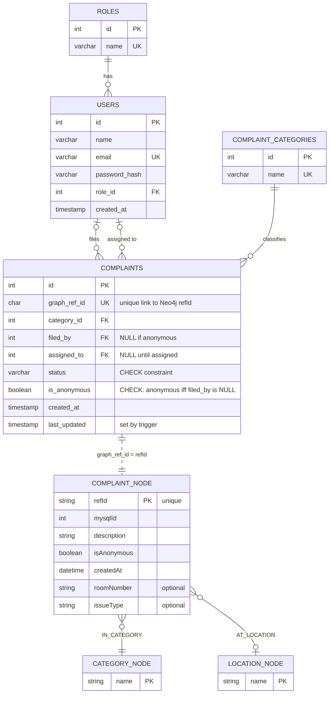

### Relational constraints summary
- `roles.name`, `users.email`, `complaint_categories.name`, and `complaints.graph_ref_id` are UNIQUE.
- `users.role_id`, `complaints.category_id`, `complaints.filed_by`, and `complaints.assigned_to` are foreign keys.
- `complaints.status` is restricted to `open`, `assigned`, `in_progress`, `resolved`, or `closed`.
- Anonymous complaints must have `filed_by IS NULL`; non-anonymous complaints must have a filer.
- `last_updated` is refreshed by `trg_update_last_updated` on every complaint update.
